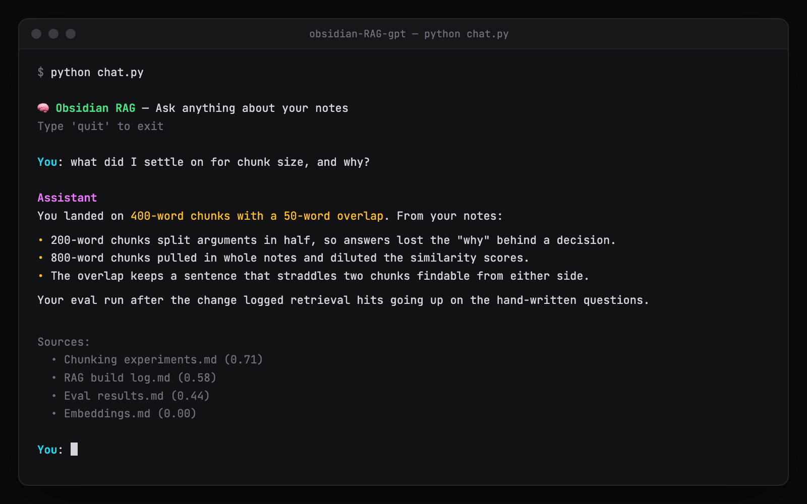
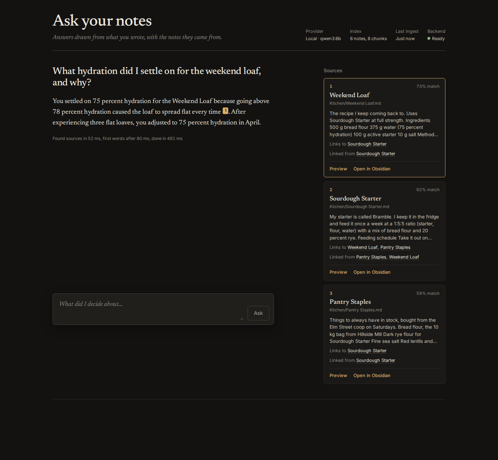

# obsidian-rag-gpt

> Ask questions about your own notes. Get answers backed by what you actually wrote.



A local RAG (Retrieval-Augmented Generation) pipeline over your Obsidian vault. Ingests your markdown notes into pgvector, retrieves semantically relevant chunks, and answers questions grounded in your actual notes. Two providers:

- **cloud**: Voyage AI embeddings + the Claude API
- **local**: Ollama (`nomic-embed-text` + `qwen3:8b`), so your notes never leave your own machines

Use it from the terminal (`chat.py`) or the web app (`server.py` + `web/`).



---

## How it works

```
Obsidian Vault (.md files)
        ↓
Ingestion (ingest.py)          Auto re-ingestion (watch.py)
  — walks vault, chunks notes    — watches vault for saves
    (long notes split at headings)
  — embeds via Voyage AI         — re-ingests changed notes on the fly
  — stores chunks + embeddings + tags in pgvector, with a full-text index
        ↓
pgvector (Postgres via Docker)
        ↓
Retrieval + Generation (rag/pipeline.py)
  — hybrid search: vectors (with similarity threshold) + keywords,
    merged with reciprocal rank fusion; optional #tag / in:Folder filters
  — expands context via [[links]] and notes that link back
  — optional rerank with the local qwen3 (off by default)
  — Claude or qwen3 answers grounded in retrieved context
        ↓
CLI chat (chat.py)  ·  HTTP API (server.py)  →  web app (web/)
```

## Stack

- **Python** — ingestion, watching, and retrieval scripts
- **PostgreSQL + pgvector** — vector storage and similarity search (Docker)
- **Voyage AI** (`voyage-3`) — document and query embeddings (cloud provider)
- **Claude API** (`claude-sonnet-4-6`) — answer generation (cloud provider)
- **Ollama** (`nomic-embed-text`, `qwen3:8b`) — embeddings and answers (local provider)
- **React + Vite + TypeScript** — web app
- **Watchdog** — filesystem watcher for auto re-ingestion
- **Rich** — CLI interface

---

## Getting started

### Prerequisites

- Python 3.10+
- Docker
- Obsidian vault with markdown notes
- For the cloud provider: a [Voyage AI API key](https://dashboard.voyageai.com) and an [Anthropic API key](https://console.anthropic.com)
- For the local provider: an [Ollama](https://ollama.com) server with `nomic-embed-text` and `qwen3:8b` pulled
- Node 20+ for the web app

### 1. Clone the repo

```bash
git clone https://github.com/yourusername/recall.git
cd recall
```

### 2. Set up Python environment

```bash
python -m venv venv
source venv/bin/activate
pip install -r requirements.txt
```

### 3. Configure environment variables

```bash
cp .env.example .env
```

Fill in your vault path and, for the cloud provider, your API keys in `.env`. Set `RAG_PROVIDER=local` to use Ollama instead (see [Local mode](#local-mode)).

### 4. Start Postgres with pgvector

With Docker Compose (reads `DB_USER`, `DB_PASSWORD`, `DB_NAME`, `DB_PORT` from `.env`; data persists in a named volume):

```bash
docker compose up -d
```

Or with plain Docker:

```bash
docker run -d \
  --name recall-db \
  -e POSTGRES_USER=your_db_user \
  -e POSTGRES_PASSWORD=your_db_password \
  -e POSTGRES_DB=obsidian_rag \
  -p 5432:5432 \
  pgvector/pgvector:pg16
```

`ingest.py` enables the `vector` extension and creates the tables on first run.

### 5. Ingest your vault

```bash
python ingest.py
```

This walks your vault, chunks each note, embeds via Voyage AI, and stores in pgvector. Re-ingestion is hash-based — unchanged files are skipped automatically.

### 6. (Optional) Watch for changes

Run this in a separate terminal to keep your index in sync as you edit notes:

```bash
python watch.py
```

It watches `VAULT_PATH` recursively and re-ingests any `.md` file the moment you save it. Press `Ctrl+C` to stop.

### 7. Start chatting

```bash
python chat.py
```

### 8. (Optional) Run the web app

```bash
python server.py            # API on http://127.0.0.1:8790
cd web && npm install && npm run dev   # app on http://127.0.0.1:5190
```

Ask a question and the answer streams in, with numbered citations that point at source cards. Each card shows the match score, the section, the note's links and backlinks, and opens the note in a preview or straight in Obsidian (`obsidian://open?vault=<VAULT_NAME>&file=...`, so set `VAULT_NAME` to your vault's name). The header shows the provider, index size, last ingest and whether the backend is up.

For a single process, build the app once (`cd web && npm run build`) and `server.py` serves it at http://127.0.0.1:8790.

API endpoints: `POST /ask` (NDJSON stream of `sources`, `token`, `done` or `error` events), `GET /search?q=`, `GET /notes/<path>`, `GET /status`, `POST /ingest`. The server only reads the vault, never writes to it.

The server answers only to `localhost`, `127.0.0.1` and the `--host` it binds to, and POSTs must be `application/json`, so other web pages open in your browser can't read your notes through it. There is no login: to reach it by another name (say your Tailscale hostname with `--host 0.0.0.0`), list that name in `RAG_ALLOWED_HOSTS` and keep it off public networks.

### 9. Run the eval harness

Score retrieval and answer quality against hand-written Q&A pairs from your notes:

```bash
# Full eval (retrieval + Claude answers)
python eval.py

# Retrieval only — fast, no LLM API calls
python eval.py --retrieval-only

# Local provider on the bundled fixture vault, no Postgres needed
python eval.py --provider local --vault tests/fixtures/vault --memory \
  --questions tests/fixtures/questions.json
```

Each question also reports retrieval and answer latency; `--json-out results.json` saves the per-question results.

Copy `eval/questions.example.json` to `eval/questions.json` and write questions about your own notes (the real file is gitignored, since it describes what is in your vault). Each case lists `expected_keywords` that should appear in retrieved context and/or the generated answer. Add `expected_sources` (note names) to also get source recall, recall in the first three notes, MRR and hit@1; `type` groups the results; `filters` (`{"tags": [...], "folder": "..."}`) is passed to retrieval. A `type` of `abstain` with no sources checks that nothing comes back.

`--retrieval`, `--chunking`, `--backlinks/--no-backlinks`, `--rerank/--no-rerank` and `--top-k` override the settings below for one run, so you can compare them on your own questions. The fixture set (`tests/fixtures/questions.json`, 57 questions) and the measurements behind the defaults are in `docs/PROGRESS-hybrid.md`.

### Retrieval settings

| Variable | Default | What it does |
|---|---|---|
| `RAG_RETRIEVAL` | `hybrid` | `hybrid`: vector and keyword rankings merged with reciprocal rank fusion. `vector`: embeddings only. |
| `RAG_CHUNKING` | `heading` | `heading`: notes longer than one chunk are split at headings, each chunk tagged with its note and section. `window`: 400-word windows over the whole note. Switching re-indexes each note once on the next ingest. |
| `RAG_BACKLINKS` | `1` | Also add one chunk from each note that links to the top hits. |
| `RAG_RERANK` | `0` | Let the local chat model reorder the candidates (local provider only). |

Filters go straight in the question: `#recipe how long in the fridge?`, `tag:book`, `in:Kitchen` or `in:"Side Projects"`. Tags match any of the given tags and include nested tags (`#book` matches `#book/fiction`). Filters limit the main hits; linked notes are still added.

---

## Local mode

Set `RAG_PROVIDER=local` in `.env` (or pass `--provider local` to any script). Embeddings come from `nomic-embed-text` (768 dimensions) and answers from `qwen3:8b`, both through Ollama's native API at `OLLAMA_URL` (default `https://pc.taila3582d.ts.net:11434`).

```bash
python ingest.py --provider local
python chat.py --provider local
python server.py --provider local
```

- **Separate index per provider.** The cloud provider keeps the original `chunks` table (1024-dim Voyage vectors); local mode writes to `chunks_nomic_768`. Switching back and forth never overwrites the other index, and migrations only add tables and columns.
- **Cold starts.** Ollama unloads idle models, so the first answer after a pause can take several seconds. Requests wait up to `OLLAMA_TIMEOUT` (180 s), and the web app says when the model is loading.
- **Server down.** If Ollama can't be reached, scripts and the web app say so plainly instead of crashing; status and note previews keep working.
- **Similarity threshold.** nomic scores run higher than Voyage's, so local mode filters at 0.5 by default (cloud: 0.35). Override with `RAG_MIN_SIMILARITY`.

To try the web app without Postgres, index a vault in memory: `python server.py --provider local --vault tests/fixtures/vault --memory`.

## Tests

```bash
python -m unittest discover -s tests -t .   # fake provider and in-memory index, no services needed
python -m tests.live                        # also calls the real Ollama
```

The tests run against `tests/fixtures/vault`, a small made-up vault with frontmatter and wikilinks.

---

## Features

- **Hash-based change detection** — only re-ingests notes that have changed
- **Auto re-ingestion** — `watch.py` keeps the index up to date as you edit notes in Obsidian
- **Hybrid search** — keyword (Postgres full-text) and vector rankings merged with reciprocal rank fusion, so exact names and codes are found as well as paraphrases
- **Tag and folder filters** — `#tag`, `tag:x` or `in:Folder` in the question
- **Heading-aware chunks** — long notes are split at headings, so a section can be found on its own
- **Link-aware retrieval** — expands retrieved context to include notes linked via `[[wikilinks]]` and notes that link back
- **Similarity threshold** — filters out low-confidence chunks before they reach the LLM
- **Source attribution** — every answer shows which notes and sections it drew from, with similarity scores
- **Local or cloud** — Ollama on your own hardware, or Voyage + Claude, each with its own index
- **Web app** — streamed answers, citations, source cards with backlinks, note previews that open in Obsidian
- **Overlapping chunks** — 400-word chunks with 50-word overlap for better context continuity
- **Obsidian markdown stripping** — cleans `[[links]]` (keeping their text), headings, frontmatter and formatting before embedding for cleaner vectors
- **Conversational memory** — chat maintains context across turns within a session
- **Eval harness** — scored Q&A pairs to measure retrieval and answer quality (`eval.py`)

## Roadmap

- [x] Watchdog-based auto re-ingestion on file save
- [x] Backlink-aware retrieval using Obsidian's `[[note]]` graph
- [x] Similarity threshold filtering
- [x] Eval harness with scored Q&A pairs
- [x] React frontend
- [x] Local provider (Ollama)
- [x] Hybrid retrieval, filters, heading-aware chunks

---

## License

MIT